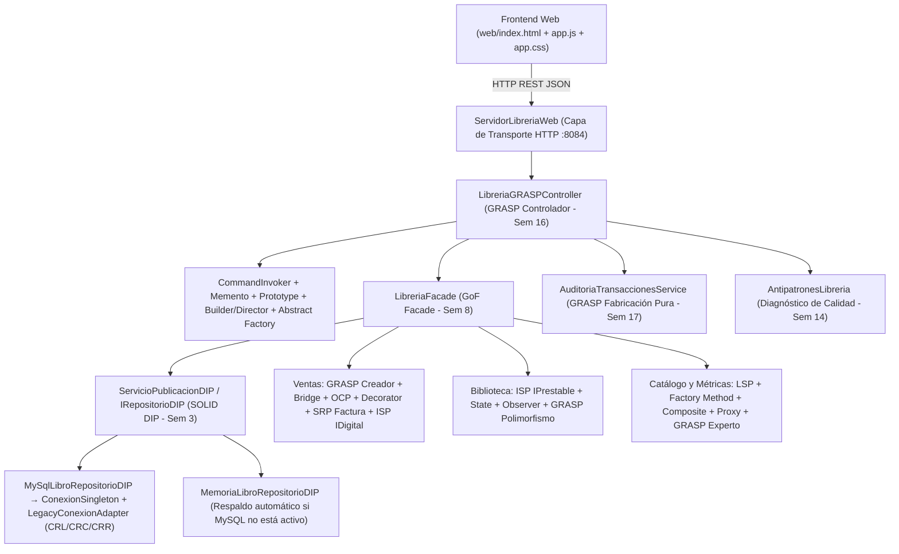

# 📚 Librería Virtual El Saber — Plataforma Web Integral con Patrones de Diseño (POO)

Sistema integral de **biblioteca y librería virtual** desarrollado con **Backend en Java 17**, persistencia en **MySQL 8.0** (con respaldo automático en memoria vía DIP) y **Frontend Web Moderno en HTML5 / CSS3 / JavaScript**, servido localmente en **`http://localhost:8084`**.

Este proyecto implementa de forma real, funcional e interconectada **todos los temas del curso de Diseño de Patrones (Semanas 1 a 17)**: principios **SOLID**, clasificación **GoF** (*Creacionales*, *Estructurales* y *Comportamiento*), **Antipatrones de Software** y patrones **GRASP**, aplicados al ciclo completo de una librería/biblioteca virtual: catálogo temático, ventas con carrito, descuentos, formatos digitales/físicos/audiolibro, préstamos y devoluciones con cálculo de mora, control de stock, reservas, notificaciones, historial Undo/Redo y auditoría en vivo.

---

## 🏗️ 1. Arquitectura General del Sistema

La plataforma sigue una arquitectura en capas desacoplada que erradica el antipatrón *God Object* y separa transporte HTTP, coordinación de casos de uso, lógica de negocio y persistencia:



---

## 🎨 2. Módulos y Funcionalidades de la Plataforma Web

1. **Catálogo Estilo E-Reader ("Selecciones especiales")**:
   - Fondo difuminado de biblioteca (`web/static/background_books.jpg`), barra superior translúcida con buscador en vivo y **Carrito de Compras** (`🛒`).
   - **4 carruseles temáticos principales** con enfoque de sección (`➜`): *Recomendados de amor*, *Novelas y cuentos para las vacaciones*, *Clásicos* y *Filosofía, Educación, Ciencia y Tecnología*.
   - **Sección Hemeroteca (Cuentos y Revistas)** generada polimórficamente mediante **LSP + Factory Method** leyendo las tablas `cuento` y `revista` de MySQL.
   - Tarjetas con portada, precio y badge real del patrón **State** (*Disponible*, *Reservar*, *Agotado*).
2. **Modal de Detalle, Venta, Préstamo, Reserva y Alerta**:
   - **Cotización en vivo** contra el backend (`/api/cotizar`) aplicando **Bridge** (Impreso Físico, E-Book Digital `-20%`, Audiolibro HD `+S/ 6.00`), **OCP** (5 estrategias de descuento) y **Decorator** (Empaque de Regalo, Garantía 30 días, Envío Express).
   - **Compra directa o Carrito de Compras** (**GRASP Creador**): valida stock físico (**ISP `IVendible`**), descuenta stock real en MySQL, actualiza **State**, emite una **Boleta Electrónica moderna (SRP)** con diseño limpio acorde a la plataforma (desglose de subtotal, descuento, extras e IGV 18%) y, si es formato digital, genera enlace de descarga (**ISP `IDigital`**).
   - **Préstamo bibliotecario** (**ISP `IPrestable`**) con DNI y plazo/mora dinámicos según **GRASP Polimorfismo**.
   - **Reserva / Liberación** (**State `EstadoReservado`**) y **Suscripción de aviso de stock** (**Observer**).
   - Indicador en vivo del **Proxy de Portadas** (`CACHE HIT` / `CACHE MISS` y tasa de aciertos).
3. **Gestión CRUD e Inventario Inteligente**:
   - **KPIs y Alertas de Reabastecimiento** (**GRASP Experto en Información**): total de títulos, unidades, valorización del inventario, stock bajo (`<= 3`) y agotados con acceso rápido para reponer stock.
   - CRUD completo conectado a MySQL (`CRL`, `Mlibro`, `Elibro`) con validación estricta **SRP (`LibroValidatorSRP`)**.
   - Herramientas integradas: **Duplicar y Plantillas (`Prototype`)**, **Asistente guiado con recetas (`Builder + DirectorPublicacion`)**, **Pack Editorial Libro+Revista (`Abstract Factory`)**, **Registrar Cuento/Revista/Libro (`Factory Method`)**, **Deshacer y Rehacer reales (`Command Undo / Redo`)** y **Instantáneas de formulario (`Memento`)**.
   - **Árbol Jerárquico del Catálogo (`Composite`)** con conteo y valorización recursiva por categoría.
4. **Préstamos, Mora Polimórfica y Centro de Alertas**:
   - Tabla de préstamos activos con botón **Devolver** (calcula mora, repone stock en BD y dispara alertas **Observer**).
   - **Calculadora de Mora Polimórfica** interactiva comparando *Libro* (14 días / S/ 2.50), *Cuento* (7 días / S/ 1.50) y *Revista* (3 días / S/ 5.00).
   - **Feed en vivo de notificaciones Observer** enviadas cuando se repone stock.
5. **Servicios Técnicos Internos (Sin pestaña visual innecesaria)**:
   - **GRASP Fabricación Pura (`AuditoriaTransaccionesService`)** y **Diagnóstico de Antipatrones (`AntipatronesLibreria`)** operan internamente en el servidor Java (consola y endpoints `/api/auditoria`, `/api/antipatrones`, `/api/arquitectura`), manteniendo la interfaz web limpia y enfocada en el catálogo, inventario y préstamos.

---

## 🗺️ 3. Mapeo Completo del Sílabo (Semanas 1 a 17)

| Semana | Unidad y Tema | Patrón / Principio | Ubicación en el Código (Clases y Métodos) | Funcionamiento Técnico Interno y Cómo Probarlo en la Web (`localhost:8084`) |
| :---: | :--- | :--- | :--- | :--- |
| **Sem 1** | **Unidad 1: SOLID** | **Responsabilidad Única (SRP)** | [`LibroSRP.java`](file:///c:/tareas/8vo/diseño%20de%20patrones/proyecto/ProyectoPoo/src/patrones/solid/srp/LibroSRP.java)<br>[`LibroValidatorSRP.java`](file:///c:/tareas/8vo/diseño%20de%20patrones/proyecto/ProyectoPoo/src/patrones/solid/srp/LibroValidatorSRP.java)<br>[`LibroFacturaSRP.java`](file:///c:/tareas/8vo/diseño%20de%20patrones/proyecto/ProyectoPoo/src/patrones/solid/srp/LibroFacturaSRP.java) | **Interno:** Separa en 3 clases el modelo de datos (`LibroSRP`), la validación de reglas de negocio (`validarConErrores()` ejecutada en cada `POST`/`PUT`) y el formateo fiscal (`generarComprobanteDetallado()`).<br>**Prueba Web:** Registra un libro con precio negativo o título vacío para ver el rechazo HTTP 400; luego compra un libro para visualizar la **Boleta Electrónica** con desglose de IGV (18%). |
| **Sem 2** | **Unidad 1: SOLID** | **Abierto / Cerrado (OCP)** | [`IDescuentoOCP.java`](file:///c:/tareas/8vo/diseño%20de%20patrones/proyecto/ProyectoPoo/src/patrones/solid/ocp/IDescuentoOCP.java)<br>[`CalculadoraPrecioOCP.java`](file:///c:/tareas/8vo/diseño%20de%20patrones/proyecto/ProyectoPoo/src/patrones/solid/ocp/CalculadoraPrecioOCP.java)<br>[`RegistroDescuentosOCP.java`](file:///c:/tareas/8vo/diseño%20de%20patrones/proyecto/ProyectoPoo/src/patrones/solid/ocp/RegistroDescuentosOCP.java)<br>`SinDescuento`, `DescuentoClienteFrecuente`, `DescuentoEstudiante`, `DescuentoVolumen`, `DescuentoTemporada` | **Interno:** `CalculadoraPrecioOCP` permanece cerrada a modificación; las 5 estrategias de descuento se registran polimórficamente en `RegistroDescuentosOCP` y se exponen vía `GET /api/descuentos`.<br>**Prueba Web:** En el modal de compra o en el carrito, cambia el selector **Promoción / Descuento (OCP)** y observa cómo se recalcula en vivo el subtotal e IGV desde el backend. |
| **Sem 2** | **Unidad 1: SOLID** | **Sustitución de Liskov (LSP)** | [`PublicacionLSP.java`](file:///c:/tareas/8vo/diseño%20de%20patrones/proyecto/ProyectoPoo/src/patrones/solid/lsp/PublicacionLSP.java)<br>[`LibroLSP.java`](file:///c:/tareas/8vo/diseño%20de%20patrones/proyecto/ProyectoPoo/src/patrones/solid/lsp/LibroLSP.java)<br>[`CuentoLSP.java`](file:///c:/tareas/8vo/diseño%20de%20patrones/proyecto/ProyectoPoo/src/patrones/solid/lsp/CuentoLSP.java)<br>[`RevistaLSP.java`](file:///c:/tareas/8vo/diseño%20de%20patrones/proyecto/ProyectoPoo/src/patrones/solid/lsp/RevistaLSP.java) | **Interno:** `LibreriaFacade.listarTodasPublicacionesLSP()` agrupa libros, cuentos y revistas en una sola `List<PublicacionLSP>`, invocando `getTipo()`, `getFichaTecnica()`, `hayStock()` y `calcularPrecioConIGV()` de manera intercambiable sin romper contratos.<br>**Prueba Web:** Mira la sección **Hemeroteca: Cuentos y Revistas** al final del Catálogo o consulta `GET /api/publicaciones`. |
| **Sem 3** | **Unidad 1: SOLID** | **Segregación de Interfaces (ISP)** | [`IPrestable.java`](file:///c:/tareas/8vo/diseño%20de%20patrones/proyecto/ProyectoPoo/src/patrones/solid/isp/IPrestable.java), [`IVendible.java`](file:///c:/tareas/8vo/diseño%20de%20patrones/proyecto/ProyectoPoo/src/patrones/solid/isp/IVendible.java), [`IDigital.java`](file:///c:/tareas/8vo/diseño%20de%20patrones/proyecto/ProyectoPoo/src/patrones/solid/isp/IDigital.java)<br>[`LibroFisicoISP.java`](file:///c:/tareas/8vo/diseño%20de%20patrones/proyecto/ProyectoPoo/src/patrones/solid/isp/LibroFisicoISP.java), [`EbookDigitalISP.java`](file:///c:/tareas/8vo/diseño%20de%20patrones/proyecto/ProyectoPoo/src/patrones/solid/isp/EbookDigitalISP.java), [`EjemplarBibliotecaISP.java`](file:///c:/tareas/8vo/diseño%20de%20patrones/proyecto/ProyectoPoo/src/patrones/solid/isp/EjemplarBibliotecaISP.java) | **Interno:** Ninguna clase implementa métodos que no necesita: `LibroFisicoISP` implementa `IPrestable + IVendible`, `EbookDigitalISP` implementa `IVendible + IDigital` (sin stock físico), y `EjemplarBibliotecaISP` implementa solo `IPrestable` (préstamo/devolución con DNI).<br>**Prueba Web:** Compra un libro en formato **E-Book Digital** para obtener el botón de descarga `IDigital`; o solicita un **Préstamo Bibliotecario** con DNI y devuélvelo en la pestaña *Préstamos y Alertas*. |
| **Sem 3** | **Unidad 1: SOLID** | **Inversión de Dependencias (DIP)** | [`IRepositorioDIP.java`](file:///c:/tareas/8vo/diseño%20de%20patrones/proyecto/ProyectoPoo/src/patrones/solid/dip/IRepositorioDIP.java)<br>[`ServicioPublicacionDIP.java`](file:///c:/tareas/8vo/diseño%20de%20patrones/proyecto/ProyectoPoo/src/patrones/solid/dip/ServicioPublicacionDIP.java)<br>[`MySqlLibroRepositorioDIP.java`](file:///c:/tareas/8vo/diseño%20de%20patrones/proyecto/ProyectoPoo/src/patrones/solid/dip/MySqlLibroRepositorioDIP.java)<br>[`MemoriaLibroRepositorioDIP.java`](file:///c:/tareas/8vo/diseño%20de%20patrones/proyecto/ProyectoPoo/src/patrones/solid/dip/MemoriaLibroRepositorioDIP.java) | **Interno:** `LibreriaFacade` depende únicamente de `ServicioPublicacionDIP<LibroSRP>` / `IRepositorioDIP<LibroSRP>`. Al iniciar, inyecta `MySqlLibroRepositorioDIP` si MySQL está conectado o conmuta automáticamente a `MemoriaLibroRepositorioDIP` si MySQL estuviera apagado, sin cambiar ni una línea de la lógica de negocio.<br>**Prueba Web:** Revisa la tarjeta **Motor DIP** en la pestaña *Auditoría*. |
| **Sem 4** | **Unidad 1: GoF** | **Concepto y Clasificación GoF** | Paquetes organizados por propósito:<br>`patrones.creacionales.*`<br>`patrones.estructurales.*`<br>`patrones.comportamiento.*`<br>Endpoint: `GET /api/arquitectura` | **Interno:** Estructura modular rigurosa según los 3 grupos de la *Gang of Four*, complementada por telemetría en vivo (`/api/arquitectura`) que reporta el estado de cada subsistema.<br>**Prueba Web:** Abre la pestaña **Auditoría** y verifica las tarjetas de telemetría en tiempo real. |
| **Sem 6** | **Unidad 2: Creacionales** | **Singleton** | [`ConexionSingleton.java`](file:///c:/tareas/8vo/diseño%20de%20patrones/proyecto/ProyectoPoo/src/patrones/creacionales/singleton/ConexionSingleton.java)<br>Método: `getInstancia()`, `getConexion()` | **Interno:** Implementación *thread-safe* con *Double-Checked Locking*, validación automática `isValid(2)` con reconexión segura, soporte de credenciales (`root`, `admin`, vacía) y contador de consultas ejecutadas.<br>**Prueba Web:** Verifica el hash único de instancia y el conteo de consultas SQL en *Auditoría*. |
| **Sem 6** | **Unidad 2: Creacionales** | **Prototype** | [`IPublicacionPrototype.java`](file:///c:/tareas/8vo/diseño%20de%20patrones/proyecto/ProyectoPoo/src/patrones/creacionales/prototype/IPublicacionPrototype.java)<br>[`LibroPrototype.java`](file:///c:/tareas/8vo/diseño%20de%20patrones/proyecto/ProyectoPoo/src/patrones/creacionales/prototype/LibroPrototype.java)<br>[`RegistroPrototipos.java`](file:///c:/tareas/8vo/diseño%20de%20patrones/proyecto/ProyectoPoo/src/patrones/creacionales/prototype/RegistroPrototipos.java) | **Interno:** Clona en memoria cualquier ficha existente (`clonarConEdicion("2da Edición")`) o instancia copias desde el catálogo de plantillas preconfiguradas (`RegistroPrototipos`).<br>**Prueba Web:** En *Gestión CRUD*, selecciona una fila y pulsa **📑 Duplicar (Prototype)**, o pulsa **📋 Plantillas** para clonar una plantilla base. |
| **Sem 7** | **Unidad 2: Creacionales** | **Factory Method** | [`PublicacionFactory.java`](file:///c:/tareas/8vo/diseño%20de%20patrones/proyecto/ProyectoPoo/src/patrones/creacionales/factory/PublicacionFactory.java)<br>[`LibroFactory.java`](file:///c:/tareas/8vo/diseño%20de%20patrones/proyecto/ProyectoPoo/src/patrones/creacionales/factory/LibroFactory.java)<br>[`CuentoFactory.java`](file:///c:/tareas/8vo/diseño%20de%20patrones/proyecto/ProyectoPoo/src/patrones/creacionales/factory/CuentoFactory.java)<br>[`RevistaFactory.java`](file:///c:/tareas/8vo/diseño%20de%20patrones/proyecto/ProyectoPoo/src/patrones/creacionales/factory/RevistaFactory.java) | **Interno:** `PublicacionFactory.obtenerFabrica(tipo)` delega en cada subclase la instanciación concreta de `LibroLSP`, `CuentoLSP` o `RevistaLSP` y su registro en MySQL (`CRL`, `CRC`, `CRR`).<br>**Prueba Web:** En *Gestión CRUD*, pulsa **🏭 Cuento/Revista**, elige el tipo y crea un cuento o revista; aparecerá inmediatamente en la *Hemeroteca* del Catálogo. |
| **Sem 7** | **Unidad 2: Creacionales** | **Abstract Factory** | [`EditorialAbstractFactory.java`](file:///c:/tareas/8vo/diseño%20de%20patrones/proyecto/ProyectoPoo/src/patrones/creacionales/abstractfactory/EditorialAbstractFactory.java)<br>[`PlanetaEditorialFactory.java`](file:///c:/tareas/8vo/diseño%20de%20patrones/proyecto/ProyectoPoo/src/patrones/creacionales/abstractfactory/PlanetaEditorialFactory.java)<br>[`NormaEditorialFactory.java`](file:///c:/tareas/8vo/diseño%20de%20patrones/proyecto/ProyectoPoo/src/patrones/creacionales/abstractfactory/NormaEditorialFactory.java)<br>[`AlfaguaraEditorialFactory.java`](file:///c:/tareas/8vo/diseño%20de%20patrones/proyecto/ProyectoPoo/src/patrones/creacionales/abstractfactory/AlfaguaraEditorialFactory.java) | **Interno:** Cada fábrica concreta crea **familias coherentes completas** de productos editoriales: un `LibroLSP` destacado (registrado con `Command` para soportar Undo) **y** una `RevistaLSP` asociada de la misma editorial.<br>**Prueba Web:** En *Gestión CRUD*, pulsa **📦 Pack Editorial** y elige *Planeta*, *Norma* o *Alfaguara*. |
| **Sem 7** | **Unidad 2: Creacionales** | **Builder + Director** | [`LibroBuilder.java`](file:///c:/tareas/8vo/diseño%20de%20patrones/proyecto/ProyectoPoo/src/patrones/creacionales/builder/LibroBuilder.java)<br>[`DirectorPublicacion.java`](file:///c:/tareas/8vo/diseño%20de%20patrones/proyecto/ProyectoPoo/src/patrones/creacionales/builder/DirectorPublicacion.java) | **Interno:** Construye libros paso a paso con opciones opcionales (`ISBN`, `tapaDura +S/12`, `ilustrado +S/8`, `conPrologo`) y recetas reutilizables en `DirectorPublicacion` (*Coleccionista*, *Bolsillo*, *Manual Académico*).<br>**Prueba Web:** En *Gestión CRUD*, pulsa **🔨 Builder + Director**, elige una receta o personaliza los atributos y registra el libro. |
| **Sem 8** | **Unidad 3: Estructurales** | **Adapter** | [`IServicioPublicacion.java`](file:///c:/tareas/8vo/diseño%20de%20patrones/proyecto/ProyectoPoo/src/patrones/estructurales/adapter/IServicioPublicacion.java)<br>[`LegacyConexionAdapter.java`](file:///c:/tareas/8vo/diseño%20de%20patrones/proyecto/ProyectoPoo/src/patrones/estructurales/adapter/LegacyConexionAdapter.java) | **Interno:** Adapta las clases JDBC heredadas del proyecto original (`ConexionLibro`, `ConexionCuento`, `ConexionRevista` con sus procedimientos `CRL`, `CRC`, `CRR`, `Mlibro`, `Elibro`) a la interfaz moderna `IServicioPublicacion` consumida por el repositorio DIP.<br>**Prueba Web:** Cada registro, modificación o eliminación en *Gestión CRUD* invoca el adaptador de forma transparente. |
| **Sem 8** | **Unidad 3: Estructurales** | **Facade** | [`LibreriaFacade.java`](file:///c:/tareas/8vo/diseño%20de%20patrones/proyecto/ProyectoPoo/src/patrones/estructurales/facade/LibreriaFacade.java) | **Interno:** Centraliza en una sola interfaz de alto nivel la orquestación de todos los subsistemas: CRUD DIP, ventas (`cotizarOComprar`), préstamos (`solicitarPrestamo`, `devolverPrestamo`), reservas (`reservarLibro`), árbol Composite, portadas Proxy y alertas Experto.<br>**Prueba Web:** Todas las operaciones de la plataforma pasan por `LibreriaFacade`. |
| **Sem 9** | **Unidad 3: Estructurales** | **Decorator** | [`IPublicacionComponent.java`](file:///c:/tareas/8vo/diseño%20de%20patrones/proyecto/ProyectoPoo/src/patrones/estructurales/decorator/IPublicacionComponent.java)<br>[`PublicacionBase.java`](file:///c:/tareas/8vo/diseño%20de%20patrones/proyecto/ProyectoPoo/src/patrones/estructurales/decorator/PublicacionBase.java)<br>[`EmpaqueRegaloDecorator.java`](file:///c:/tareas/8vo/diseño%20de%20patrones/proyecto/ProyectoPoo/src/patrones/estructurales/decorator/EmpaqueRegaloDecorator.java)<br>[`GarantiaExtendidaDecorator.java`](file:///c:/tareas/8vo/diseño%20de%20patrones/proyecto/ProyectoPoo/src/patrones/estructurales/decorator/GarantiaExtendidaDecorator.java)<br>[`EnvioExpressDecorator.java`](file:///c:/tareas/8vo/diseño%20de%20patrones/proyecto/ProyectoPoo/src/patrones/estructurales/decorator/EnvioExpressDecorator.java) | **Interno:** Envuelve dinámicamente la publicación con responsabilidades adicionales acumulables (`+S/ 5.00` Empaque Regalo, `+S/ 3.50` Garantía 30 días, `+S/ 8.00` Envío Express) sin lógica hardcodeada ni explosión de subclases.<br>**Prueba Web:** Marca cualquier combinación de extras en el modal de compra o carrito y verifica el desglose y la boleta emitida. |
| **Sem 9** | **Unidad 3: Estructurales** | **Composite** | [`ICatalogoComponent.java`](file:///c:/tareas/8vo/diseño%20de%20patrones/proyecto/ProyectoPoo/src/patrones/estructurales/composite/ICatalogoComponent.java)<br>[`CategoriaComposite.java`](file:///c:/tareas/8vo/diseño%20de%20patrones/proyecto/ProyectoPoo/src/patrones/estructurales/composite/CategoriaComposite.java)<br>[`ItemCatalogoLeaf.java`](file:///c:/tareas/8vo/diseño%20de%20patrones/proyecto/ProyectoPoo/src/patrones/estructurales/composite/ItemCatalogoLeaf.java) | **Interno:** Construye el árbol real `Librería Virtual El Saber → Categorías → Libros`, ejecutando de forma recursiva `contarItems()`, `contarStockTotal()`, `calcularValorInventario()` y `toJson()` vía `GET /api/catalogo/arbol`.<br>**Prueba Web:** En *Gestión CRUD*, despliega el panel **🌳 Árbol Jerárquico del Catálogo (Composite)** al final de la vista. |
| **Sem 11** | **Unidad 3: Estructurales** | **Proxy** | [`ICoverService.java`](file:///c:/tareas/8vo/diseño%20de%20patrones/proyecto/ProyectoPoo/src/patrones/estructurales/proxy/ICoverService.java)<br>[`RealCoverService.java`](file:///c:/tareas/8vo/diseño%20de%20patrones/proyecto/ProyectoPoo/src/patrones/estructurales/proxy/RealCoverService.java)<br>[`ProxyCoverService.java`](file:///c:/tareas/8vo/diseño%20de%20patrones/proyecto/ProyectoPoo/src/patrones/estructurales/proxy/ProxyCoverService.java) | **Interno:** Proxy de caché concurrente (`ConcurrentHashMap`) que intercepta `/api/portada?titulo=...`, evita la latencia de `RealCoverService` en accesos repetidos y mide `cacheHits`, `cacheMisses` y porcentaje `hitRate`.<br>**Prueba Web:** Abre un libro en el Catálogo (verás `Proxy: CACHE MISS`), ciérralo y vuélvelo a abrir (verás `Proxy: CACHE HIT ⚡`) y consulta las métricas en *Auditoría*. |
| **Sem 11** | **Unidad 3: Estructurales** | **Bridge** | [`IFormatoBridge.java`](file:///c:/tareas/8vo/diseño%20de%20patrones/proyecto/ProyectoPoo/src/patrones/estructurales/bridge/IFormatoBridge.java)<br>[`PublicacionBridge.java`](file:///c:/tareas/8vo/diseño%20de%20patrones/proyecto/ProyectoPoo/src/patrones/estructurales/bridge/PublicacionBridge.java)<br>[`LibroBridge.java`](file:///c:/tareas/8vo/diseño%20de%20patrones/proyecto/ProyectoPoo/src/patrones/estructurales/bridge/LibroBridge.java), [`RevistaBridge.java`](file:///c:/tareas/8vo/diseño%20de%20patrones/proyecto/ProyectoPoo/src/patrones/estructurales/bridge/RevistaBridge.java)<br>`FormatoFisico`, `FormatoDigitalEbook`, `FormatoAudiolibro` | **Interno:** Desacopla la jerarquía de publicaciones (`LibroBridge`, `RevistaBridge`) de su medio de entrega (`Impreso Físico`, `E-Book Digital -20%`, `Audiolibro HD +S/ 6.00`), controlando además si la compra consume o no stock físico (`consumeStockFisico()`).<br>**Prueba Web:** En un libro agotado (`stock: 0`), selecciona **E-Book Digital** o **Audiolibro HD** para adquirirlo sin requerir stock físico. |
| **Sem 12** | **Unidad 4: Comportamiento** | **State** | [`IEstadoPublicacion.java`](file:///c:/tareas/8vo/diseño%20de%20patrones/proyecto/ProyectoPoo/src/patrones/comportamiento/state/IEstadoPublicacion.java)<br>[`ContextoPublicacion.java`](file:///c:/tareas/8vo/diseño%20de%20patrones/proyecto/ProyectoPoo/src/patrones/comportamiento/state/ContextoPublicacion.java)<br>`EstadoDisponible`, `EstadoReservado`, `EstadoAgotado` | **Interno:** Cada libro mantiene su máquina de estados real en el backend. Al vender/prestar la última unidad transiciona automáticamente a `EstadoAgotado`; al reservar pasa a `EstadoReservado` (bloqueando préstamos hasta liberar); al reponer/devolver vuelve a `EstadoDisponible`.<br>**Prueba Web:** Pulsa **Reservar Ejemplar** y **Liberar Reserva** en el modal de detalle, o agota el stock de un libro comprándolo. |
| **Sem 12** | **Unidad 4: Comportamiento** | **Observer** | [`IObserverCliente.java`](file:///c:/tareas/8vo/diseño%20de%20patrones/proyecto/ProyectoPoo/src/patrones/comportamiento/observer/IObserverCliente.java)<br>[`ClienteObserver.java`](file:///c:/tareas/8vo/diseño%20de%20patrones/proyecto/ProyectoPoo/src/patrones/comportamiento/observer/ClienteObserver.java)<br>[`StockObservable.java`](file:///c:/tareas/8vo/diseño%20de%20patrones/proyecto/ProyectoPoo/src/patrones/comportamiento/observer/StockObservable.java) | **Interno:** Gestiona suscripciones por título específico y globales. Al aumentar stock vía `PUT /api/libros` o al devolver un préstamo, `notificarTodos()` dispara avisos automáticos y los registra en el feed.<br>**Prueba Web:** Suscribe tu correo en un libro agotado, luego aumenta su stock en *Gestión CRUD* y mira la notificación generada en *Préstamos y Alertas*. |
| **Sem 13** | **Unidad 4: Comportamiento** | **Command (Undo / Redo)** | [`ICommand.java`](file:///c:/tareas/8vo/diseño%20de%20patrones/proyecto/ProyectoPoo/src/patrones/comportamiento/command/ICommand.java)<br>[`CommandInvoker.java`](file:///c:/tareas/8vo/diseño%20de%20patrones/proyecto/ProyectoPoo/src/patrones/comportamiento/command/CommandInvoker.java)<br>[`RegistrarLibroCommand.java`](file:///c:/tareas/8vo/diseño%20de%20patrones/proyecto/ProyectoPoo/src/patrones/comportamiento/command/RegistrarLibroCommand.java)<br>[`ModificarLibroCommand.java`](file:///c:/tareas/8vo/diseño%20de%20patrones/proyecto/ProyectoPoo/src/patrones/comportamiento/command/ModificarLibroCommand.java)<br>[`EliminarLibroCommand.java`](file:///c:/tareas/8vo/diseño%20de%20patrones/proyecto/ProyectoPoo/src/patrones/comportamiento/command/EliminarLibroCommand.java) | **Interno:** Encapsula registros (capturando el ID real generado), modificaciones (guardando estado previo y nuevo) y eliminaciones (respaldando el objeto real) en dos pilas (`historialDeshacer` y `historialRehacer`).<br>**Prueba Web:** Registra, modifica o elimina un libro en *Gestión CRUD* y usa los botones **↩️ Undo** y **↪️ Redo** para revertir y reaplicar los cambios en MySQL. |
| **Sem 13** | **Unidad 4: Comportamiento** | **Memento** | [`LibroMemento.java`](file:///c:/tareas/8vo/diseño%20de%20patrones/proyecto/ProyectoPoo/src/patrones/comportamiento/memento/LibroMemento.java)<br>[`LibroOriginator.java`](file:///c:/tareas/8vo/diseño%20de%20patrones/proyecto/ProyectoPoo/src/patrones/comportamiento/memento/LibroOriginator.java)<br>[`CaretakerHistorial.java`](file:///c:/tareas/8vo/diseño%20de%20patrones/proyecto/ProyectoPoo/src/patrones/comportamiento/memento/CaretakerHistorial.java) | **Interno:** Guarda instantáneas inmutables del estado del formulario CRUD evitando duplicados consecutivos, manteniendo un historial navegable sin violar la encapsulación.<br>**Prueba Web:** Escribe datos en el formulario CRUD, pulsa **🧹 Limpiar** y luego **🕒 Memento** para restaurar automáticamente tus campos. |
| **Sem 14** | **Unidad 4: Calidad** | **Antipatrones de Software** | [`AntipatronesLibreria.java`](file:///c:/tareas/8vo/diseño%20de%20patrones/proyecto/ProyectoPoo/src/patrones/antipatrones/AntipatronesLibreria.java)<br>Método: `generarReporteJson()` | **Interno:** Genera un reporte diagnóstico en tiempo real de **6 antipatrones** (4 de desarrollo: *God Object*, *Spaghetti Code / Hardcoded SQL*, *Lava Flow*, *Golden Hammer*; y 2 organizacionales: *Analysis Paralysis*, *Bicycle Shedding*) contrastando malas prácticas vs. las mitigaciones activas en este sistema.<br>**Prueba Web:** Abre la pestaña **Auditoría** y revisa el panel *Antipatrones Evaluados*. |
| **Sem 16** | **Unidad 5: GRASP** | **Controlador y Creador** | [`LibreriaGRASPController.java`](file:///c:/tareas/8vo/diseño%20de%20patrones/proyecto/ProyectoPoo/src/patrones/grasp/controlador/LibreriaGRASPController.java)<br>[`VentaItemCreator.java`](file:///c:/tareas/8vo/diseño%20de%20patrones/proyecto/ProyectoPoo/src/patrones/grasp/creador/VentaItemCreator.java) | **Interno:** `LibreriaGRASPController` recibe el 100% de los eventos provenientes de `ServidorLibreriaWeb` (desacoplando el protocolo HTTP de la lógica de aplicación). `VentaItemCreator.OrdenVenta` crea y administra sus propias `LineaVenta` al procesar compras y carrito.<br>**Prueba Web:** Agrega varios libros al **🛒 Carrito** y emite una factura consolidada. |
| **Sem 17** | **Unidad 5: GRASP** | **Experto, Fabricación Pura y Polimorfismo** | [`PublicacionExperto.java`](file:///c:/tareas/8vo/diseño%20de%20patrones/proyecto/ProyectoPoo/src/patrones/grasp/experto/PublicacionExperto.java)<br>[`AuditoriaTransaccionesService.java`](file:///c:/tareas/8vo/diseño%20de%20patrones/proyecto/ProyectoPoo/src/patrones/grasp/fabricacionpura/AuditoriaTransaccionesService.java)<br>[`IRecursoBiblioteca.java`](file:///c:/tareas/8vo/diseño%20de%20patrones/proyecto/ProyectoPoo/src/patrones/grasp/polimorfismo/IRecursoBiblioteca.java) (`RecursoLibro`, `RecursoCuento`, `RecursoRevista`) | **Interno:**<br>• **Experto:** Calcula IGV, valorización total y nivel de alerta (`AGOTADO` / `STOCK_BAJO` / `OPTIMO`) vía `/api/inventario/metricas`.<br>• **Fabricación Pura:** Centraliza el log auditable etiquetado por patrón sin contaminar las entidades del dominio.<br>• **Polimorfismo:** Resuelve plazos y moras (`calcularMoraTotal()`) según el tipo de publicación sin `if/else` rígidos.<br>**Prueba Web:** Revisa KPIs/alertas en *Gestión CRUD*, la *Calculadora de Mora* en *Préstamos y Alertas* y la consola en *Auditoría*. |

---

## 🔌 4. Endpoints REST Implementados (`http://localhost:8084`)

| Endpoint | Método(s) | Patrones Involucrados | Función |
| :--- | :---: | :--- | :--- |
| `/api/libros` | `GET`, `POST`, `PUT`, `DELETE` | GRASP Controller, Facade, DIP, SRP, Adapter, Command, State, Observer | CRUD completo de libros con validación SRP, estado State y notificaciones Observer. |
| `/api/publicaciones` | `GET`, `POST` | LSP, Factory Method, Adapter (`CRL`/`CRC`/`CRR`), GRASP Polimorfismo | Lista y registra polimórficamente Libros, Cuentos y Revistas. |
| `/api/cotizar` / `/api/comprar` | `POST` | GRASP Creador, Bridge, OCP, Decorator, ISP (`IVendible`/`IDigital`), SRP Factura | Cotización en vivo y facturación de compra directa o carrito con descuento de stock real. |
| `/api/descarga-digital` | `GET` | ISP (`IDigital`), Bridge (`FormatoDigitalEbook`) | Descarga simulada de licencia E-Book al comprar formato digital. |
| `/api/prestamos` / `/api/prestamos/devolver` | `GET`, `POST` | ISP (`IPrestable`), State, GRASP Polimorfismo, Observer | Registro y devolución de préstamos bibliotecarios con cálculo de mora y reposición de stock. |
| `/api/mora` | `GET` | GRASP Polimorfismo (`IRecursoBiblioteca`) | Cálculo polimórfico de mora según tipo (`libro`, `cuento`, `revista`) y días de retraso. |
| `/api/reservar` / `/api/reservar/liberar` | `POST` | State (`EstadoReservado` ↔ `EstadoDisponible`/`EstadoAgotado`) | Cambia explícitamente el estado de un ejemplar a reservado o lo libera. |
| `/api/suscribir` | `GET`, `POST` | Observer (`StockObservable`, `ClienteObserver`) | Registra alertas por libro y devuelve historial de avisos despachados. |
| `/api/clonar` / `/api/prototipos` | `POST`, `GET` | Prototype (`LibroPrototype`, `RegistroPrototipos`) | Clona una ficha seleccionada o instancia una plantilla preconfigurada. |
| `/api/builder` | `POST` | Builder + `DirectorPublicacion`, Command | Construye publicaciones personalizadas o por receta (Coleccionista, Bolsillo, Académico). |
| `/api/editorial` | `POST` | Abstract Factory (`Planeta`, `Norma`, `Alfaguara`), Command | Importa un pack completo (Libro + Revista) de la editorial seleccionada. |
| `/api/undo` / `/api/redo` / `/api/comandos` | `POST`, `GET` | Command (`CommandInvoker`) | Deshace/rehace operaciones CRUD reales y consulta el estado de las pilas. |
| `/api/memento` | `GET`, `POST` | Memento (`LibroOriginator`, `CaretakerHistorial`) | Guarda, lista y restaura instantáneas del formulario CRUD. |
| `/api/catalogo/arbol` | `GET` | Composite (`CategoriaComposite`, `ItemCatalogoLeaf`) | Devuelve el árbol jerárquico con conteo y valorización recursiva. |
| `/api/portada` | `GET` | Proxy (`ProxyCoverService`, `RealCoverService`) | Sirve metadatos visuales de portadas con caché y reporta hits/misses. |
| `/api/inventario/metricas` | `GET` | GRASP Experto en Información (`PublicacionExperto`) | Calcula KPIs del inventario y alertas de reabastecimiento (`stock <= 3`). |
| `/api/descuentos` | `GET` | OCP (`RegistroDescuentosOCP`) | Lista todas las promociones registradas dinámicamente. |
| `/api/antipatrones` / `/api/arquitectura` / `/api/auditoria` | `GET` | Antipatrones, Singleton, DIP, Proxy, GRASP Fabricación Pura | Diagnóstico de calidad, telemetría de patrones y consola de auditoría en vivo. |

---

## ⚡ 5. Instrucciones de Ejecución Rápida (Listo para Correr)

El proyecto ya viene **compilado y listo para ejecutarse** tanto en `build/classes` como en `bin` (con Java 17 y el conector MySQL en `lib/mysql-connector-j-9.3.0.jar`).

### Opción A — Desde Visual Studio Code:
1. Abre la carpeta del proyecto en VS Code.
2. Presiona **`F5`** (ejecuta la configuración *"Ejecutar Servidor Web (localhost:8084)"* de `.vscode/launch.json`).
3. Abre tu navegador en **`http://localhost:8084`**.

### Opción B — Desde Terminal / Explorador de Windows:
Ejecuta cualquiera de los scripts incluidos en la raíz del proyecto:
```powershell
.\ejecutar.bat
```
o en PowerShell:
```powershell
.\ejecutar.ps1
```

### Recompilación manual (si modificas archivos `.java`):
```powershell
$files = Get-ChildItem -Recurse src -Filter *.java | ForEach-Object { $_.FullName }
javac -encoding UTF-8 -d build/classes -cp "lib/*;src" $files
javac -encoding UTF-8 -d bin -cp "lib/*;src" $files
```

---

## 🗄️ 6. Base de Datos MySQL (`libreria_ElSaber`) y Respaldo Automático

- **Esquema SQL incluido:** [`libreria_ElSaber.sql`](file:///c:/tareas/8vo/diseño%20de%20patrones/proyecto/ProyectoPoo/libreria_ElSaber.sql) (tablas `libro`, `cuento`, `revista`, `cliente`, `producto` y procedimientos almacenados `CRL`, `CRC`, `CRR`).
- **Conexión inteligente (`ConexionSingleton`):** Intenta conectar a `jdbc:mysql://localhost:3306/libreria_ElSaber` probando credenciales `root`/`root`, `root`/`admin` y contraseña vacía.
- **Siembra automática sin duplicados:** Si la tabla `libro` tiene pocos registros iniciales, `MySqlLibroRepositorioDIP` completa automáticamente el catálogo temático de la librería virtual verificando títulos existentes para evitar duplicados.
- **Respaldo automático (SOLID DIP):** Si ejecutas la aplicación en un equipo sin MySQL activo, el sistema conmuta automáticamente a `MemoriaLibroRepositorioDIP` para que toda la página, compras, préstamos y CRUD sigan funcionando sin fallar.
